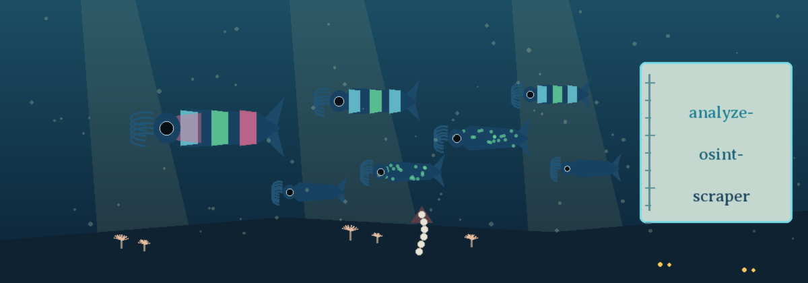
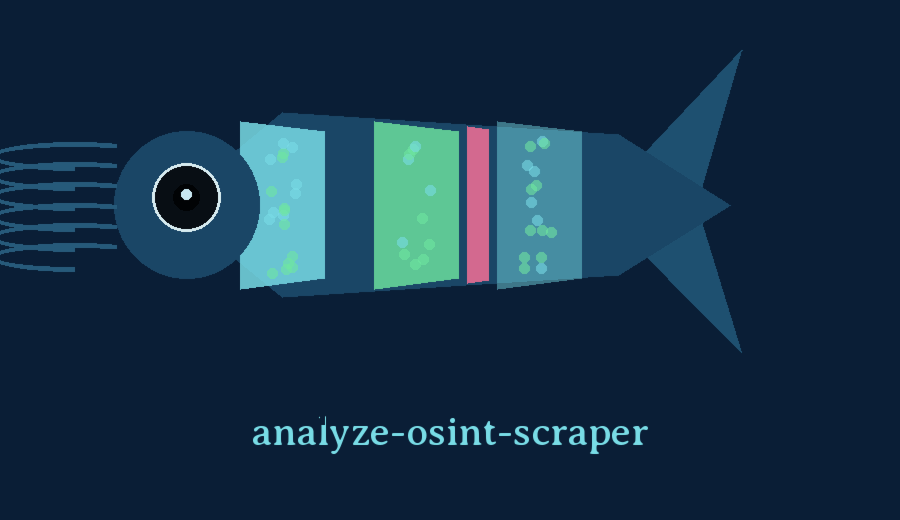

# analyze-osint-scraper

# analyze-osint-scraper
Scrapes OSINT sources (e.g., social media, forums, pastebins) for mentions of specific keywords or IOCs. Uses libraries like `requests` and `beautifulsoup4`. - Focused on Data analysis and reporting

## Install
`git clone https://github.com/ShadowGuardAI/analyze-osint-scraper`

## Usage
`./analyze-osint-scraper [params]`

## Parameters
- `-h`: Show help message and exit
- `-k`: List of keywords to search for.
- `-i`: No description provided
- `-u`: List of URLs to scrape.
- `-o`: Output CSV file path.
- `--max_pages`: Maximum number of pages to scrape per URL.  Useful for sites with pagination. Defaults to 1.

Exit status: the tool exits 1 if the results CSV cannot be written, or if every named URL failed to fetch. When some pages could not be fetched, a partial failure status is printed and the run exits 0 with the results from the pages that were fetched.

> Lure light note: -i arrives with no description in the source, and it sits between the keyword list and the URL list, the two flags a new user needs most. No purpose is guessed for it here.

> Lure light note: a partial fetch failure still exits 0 with the results from the pages that were fetched, while total failure, every named URL failed or the CSV unwritable, exits 1. The two outcomes are easy to misread as one.

## License
Copyright (c) ShadowGuardAI
